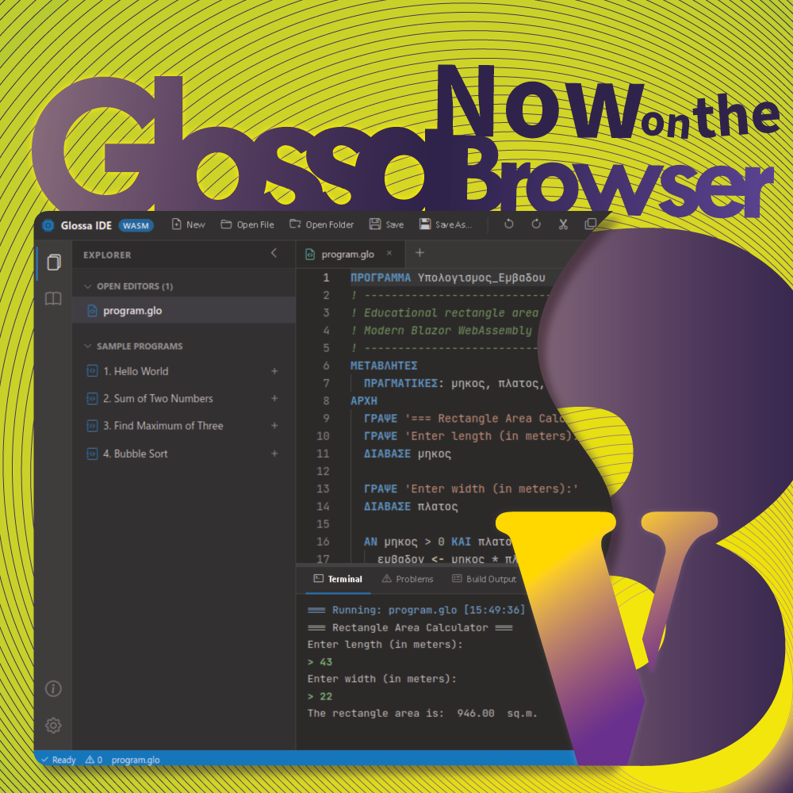

# Glossa IDE — Γλώσσα WebAssembly (PWA)

> **Glossa IDE** is a modern, high-density, professional browser-based IDE for **Γλώσσα (Glossa)** — the pseudocode programming language taught in the 3rd grade of senior high school in Greece and tested in the Panhellenic university-entrance examinations.

Built from the ground up on **Blazor WebAssembly** (.NET 8/9/10), it runs completely client-side in the browser as a standalone Progressive Web App (PWA), requiring zero server-side infrastructure and integrating the complete parser & interpreter from [`markoutso/glo`](https://github.com/markoutso/glo) via JavaScript Interop.



---

## Table of Contents

- [Architectural Overview](#architectural-overview)
- [Key Features](#key-features)
- [Project Directory Structure](#project-directory-structure)
- [System Prerequisites](#system-prerequisites)
- [Quick Start: Build & Run Locally](#quick-start-build--run-locally)
- [Build, Run & Clean Instructions](#build-run--clean-instructions)
  - [1. Building the Application](#1-building-the-application)
  - [2. Running the Application](#2-running-the-application)
  - [3. Cleaning Build Artifacts](#3-cleaning-build-artifacts)
- [Bilingual Support (English & Greek)](#bilingual-support-english--greek)
- [Code Formatting & File Save Dialogs](#code-formatting--file-save-dialogs)
- [Production Release & Static Deployment](#production-release--static-deployment)
- [Compiler & Runtime Integration Details](#compiler--runtime-integration-details)
- [Keyboard Shortcuts](#keyboard-shortcuts)
- [Troubleshooting](#troubleshooting)
- [License](#license)

---

## Architectural Overview

```
┌────────────────────────────────────────────────────────────────────────┐
│                        Modern Web Browser                              │
│                                                                        │
│  ┌─────────────────────────┐          JS Interop          ┌──────────┐ │
│  │   Blazor WebAssembly    │◄────────────────────────────►│   glo    │ │
│  │   (C# / Razor .NET)     │   window.glossaBridge        │  Engine  │ │
│  │                         │   window.monacoInterop       │ (Parser/ │ │
│  │  • MainLayout & Toolbar │                              │ Interpr) │ │
│  │  • File / Theme Service │                              └──────────┘ │
│  │  • Execution Service    │                                    │      │
│  └─────────────────────────┘                                    │      │
│               │                                                 │      │
│               ▼                                                 ▼      │
│  ┌─────────────────────────┐                             Standard I/O  │
│  │      Monaco Editor      │                             (ΓΡΑΨΕ/ΔΙΑΒΑΣΕ│
│  │   • Monarch Tokenizer   │◄───────────────────────────────────┘      │
│  │   • ΓΛΩΣΣΑ Snippets     │                                           │
│  │   • Error Diagnostics   │                                           │
│  └─────────────────────────┘                                           │
│               │                                                        │
│               ▼                                                        │
│  ┌───────────────────────────────────────────────────────────────┐     │
│  │             Progressive Web App Service Worker                │     │
│  │      (Offline asset caching & stand-alone installation)       │     │
│  └───────────────────────────────────────────────────────────────┘     │
└────────────────────────────────────────────────────────────────────────┘
```

1. **Client-Side WASM Execution:** All C# components run directly on the browser's WebAssembly virtual machine via `.NET WASM`.
2. **`glo` Compiler Bridge:** Glossa source code is passed via `IJSRuntime` to `glo-bridge.js`. The interpreter streams output (`ΓΡΑΨΕ`/`ΤΥΠΩΣΕ`) in real time and handles interactive keyboard prompts (`ΔΙΑΒΑΣΕ`) via asynchronous promises.
3. **Monaco Editor:** Industry-standard code editor with custom Monarch syntax highlighter, diagnostic error markers, and autocompletion templates.
4. **Serverless Static Hosting:** Compiles entirely down to static files (`index.html`, `_framework/`, `.wasm`, `.js`, `.css`), deployable to GitHub Pages, Cloudflare Pages, Netlify, or Azure Static Web Apps.

---

## Key Features

- **VS Code-Inspired 3-Panel Layout:**
  - **Activity Bar & Sidebar:** Collapsible panels with File Explorer (active files, open folder tree with expand/collapse, dirty markers), Educational Sample Programs (from Greek curriculum), ΓΛΩΣΣΑ Syntax Cheatsheet, Settings, and an About view.
  - **Main Editor with Multi-Tab Support:** Full multi-tab editing just like VS Code! Open multiple files simultaneously, switch between tabs seamlessly, double-click to rename tabs inline, close individual tabs with unsaved-changes confirmation dialogs, and enjoy native Greek character rendering without yellow highlight boxes.
  - **Bottom Terminal Panel:** Interactive Terminal (supporting `ΔΙΑΒΑΣΕ` prompts and `ΓΡΑΨΕ` output), Problems table (clickable error lines), and Build Logs.
- **English UI:** Clean, intuitive, fully English user interface throughout all menus, toolbars, sidebar panels, dialogs, and status bar indicators.
- **First-Class Theme System:** Full Dark (`glossa-dark`) and Light (`glossa-light`) themes with CSS custom properties and instant switching.
- **Modern File System & Folder Access API:** Open individual `.glo` / `.glossa` files or open entire local directories to browse and edit project workspaces with collapsible folder trees. "Save As..." brings up native system file save picker dialogs.
- **Offline PWA Support:** Fully usable offline once cached by the service worker.

---

## Project Directory Structure

```
Glossa/
├── GlossaWeb/                       # Blazor WebAssembly .NET Project
│   ├── Components/                  # Reusable UI Razor Components
│   │   ├── ActivityBar.razor        #   Left icon rail (48px)
│   │   ├── CodeEditor.razor         #   Monaco editor container & tab strip
│   │   ├── Sidebar.razor            #   Explorer, Cheatsheet & Settings
│   │   ├── StatusBar.razor          #   Bottom status bar (Ln, Col, state)
│   │   ├── TerminalPanel.razor      #   Terminal, Problems & Build logs
│   │   └── Toolbar.razor            #   Top actions (File, Edit, Run, Theme)
│   ├── Layout/
│   │   └── MainLayout.razor         #   Root application layout
│   ├── Models/
│   │   └── GlossaModels.cs          #   State, diagnostics, and settings models
│   ├── Pages/
│   │   ├── Home.razor               #   Main IDE orchestrator view ("/")
│   │   └── NotFound.razor           #   404 fallback page
│   ├── Services/
│   │   ├── EditorInteropService.cs  #   Monaco C# interop wrapper
│   │   ├── FileService.cs           #   File System Access API & clipboard
│   │   ├── GlossaCompilerService.cs #   Typed IGlossaExecutionService
│   │   └── ThemeService.cs          #   Dark/Light theme manager
│   ├── wwwroot/                     # Static Web Assets
│   │   ├── css/
│   │   │   └── app.css              #   Design token system & IDE styling
│   │   ├── js/
│   │   │   ├── editor-interop.js    #   Monaco setup, tokenizer & snippets
│   │   │   ├── file-interop.js      #   Browser File System API bridge
│   │   │   ├── glo-bridge.js        #   Runtime I/O bridge for glo
│   │   │   └── glo.bundle.js        #   Compiled standalone glo compiler
│   │   ├── favicon.png
│   │   ├── icon-192.png
│   │   ├── icon-512.png
│   │   ├── index.html               #   SPA host page with boot screen
│   │   ├── manifest.webmanifest     #   PWA manifest
│   │   └── service-worker.js        #   Service worker for offline caching
│   ├── App.razor                    # App root router
│   ├── GlossaWeb.csproj             # .NET Project definition
│   ├── Program.cs                   # DI container and startup
│   └── _Imports.razor               # Global Razor imports
├── glo/                             # Local clone of markoutso/glo JS compiler
├── build-glo-bundle.js              # Script to build glo.bundle.js
├── README.md                        # Documentation (You are here)
└── LICENSE                          # GNU GPL v3
```

---

## System Prerequisites

Install the following tools before starting local development:

| Prerequisite | Minimum Version | Purpose | Download |
|:---|:---|:---|:---|
| **.NET SDK** | **8.0 LTS**, **9.0**, or **10.0** | Build and host the Blazor WASM application | [dot.net/download](https://dot.net/download) |
| **Node.js** | **18 LTS** or newer | Bundle the `glo` compiler engine | [nodejs.org](https://nodejs.org/) |
| **Yarn (v1 Classic)** | **1.22+** | Dependency management for `glo` | `npm install --global yarn` |

Verify your environment by running:

```bash
dotnet --version
node --version
yarn --version
```

---

## Quick Start: Build & Run Locally

### 1. Clone Repository & Submodules

```bash
git clone https://github.com/bill-chamal/Glossa.git
cd Glossa
```

If the `glo/` folder is empty or not yet cloned:

```bash
git clone https://github.com/markoutso/glo.git glo
```

### 2. Bundle the `glo` Compiler Engine

Install dependencies in `glo` and compile the browser distribution bundle:

```bash
# Navigate to glo monorepo
cd glo
yarn install
yarn run bootstrap
yarn run build
cd ..

# Build the browser bundle (outputs to GlossaWeb/wwwroot/js/glo.bundle.js)
node --openssl-legacy-provider build-glo-bundle.js
```

> **Note:** `glo.bundle.js` (~580 KB uncompressed, ~58 KB Brotli-compressed) bundles the entire parser, lexer, semantic analyzer, and interpreter into a single standalone script.

### 3. Restore .NET Dependencies & Build

```bash
# Restore NuGet dependencies
dotnet restore GlossaWeb/GlossaWeb.csproj

# Build in Debug mode
dotnet build GlossaWeb/GlossaWeb.csproj
```

### 4. Run with Hot-Reload (`dotnet watch`)

To launch the local development server with **Hot-Reload** (changes to `.razor`, `.cs`, `.js`, or `.css` update immediately in the browser):

```bash
dotnet watch --project GlossaWeb/GlossaWeb.csproj
```

The output will confirm the local server URLs:

```text
info: Microsoft.Hosting.Lifetime[14]
      Now listening on: http://localhost:5044
info: Microsoft.Hosting.Lifetime[14]
      Now listening on: https://localhost:7223
```

### 5. Access in the Browser & Debugging

Open your browser to:

| Protocol | Local Development URL |
|:---|:---|
| **HTTP** | **[http://localhost:5044](http://localhost:5044)** |
| **HTTPS** | **[https://localhost:7223](https://localhost:7223)** |

> **Development Certificate Note:** If accessing via HTTPS, you can trust the local development certificate with:
> ```bash
> dotnet dev-certs https --trust
> ```

---

## Build, Run & Clean Instructions

### 1. Building the Application

| Action | Command | Description |
|:---|:---|:---|
| **Restore NuGet packages** | `dotnet restore GlossaWeb/GlossaWeb.csproj` | Restores all .NET package dependencies |
| **Debug Build** | `dotnet build GlossaWeb/GlossaWeb.csproj` | Compiles C# and Razor files into `bin/Debug/` |
| **Release Build** | `dotnet build GlossaWeb/GlossaWeb.csproj -c Release` | Compiles with Release optimizations |
| **Static Web Publish** | `dotnet publish GlossaWeb/GlossaWeb.csproj -c Release -o dist` | Generates standalone static web assets in `dist/wwwroot/` |
| **Compiler Engine Bundle** | `node --openssl-legacy-provider build-glo-bundle.js` | Bundles `glo` parser/interpreter into `wwwroot/js/glo.bundle.js` |

### 2. Running the Application

| Mode | Command | Details |
|:---|:---|:---|
| **Hot-Reload Development** | `dotnet watch --project GlossaWeb/GlossaWeb.csproj` | Automatic browser reload on `.razor`, `.cs`, `.js`, and `.css` edits |
| **Standard Run** | `dotnet run --project GlossaWeb/GlossaWeb.csproj` | Runs the development web server without file watching |
| **Static Production Serve (Python)** | `python3 -m http.server 8080 --directory dist/wwwroot` | Serves compiled static assets locally on port 8080 |
| **Static Production Serve (Node.js)** | `npx serve dist/wwwroot -p 8080` | High-performance static server with automatic MIME handling |

### 3. Cleaning Build Artifacts

To remove compiled outputs, temporary cache files, and intermediate assemblies:

#### Standard Clean (.NET CLI)
```bash
dotnet clean GlossaWeb/GlossaWeb.csproj
```
Removes compiled binaries and intermediate build files managed by MSBuild.

#### Deep Clean (Fresh Build State)
To completely delete all `bin/`, `obj/`, `dist/`, and local CLI cache directories:

- **On Linux / macOS:**
  ```bash
  rm -rf GlossaWeb/bin GlossaWeb/obj dist .dotnet_home
  ```

- **On Windows (PowerShell):**
  ```powershell
  Remove-Item -Recurse -Force GlossaWeb\bin, GlossaWeb\obj, dist, .dotnet_home -ErrorAction SilentlyContinue
  ```

#### Cleaning Compiler Engine (`glo`)
`glo` is a Lerna monorepo with 13 sub-packages. When bootstrapped, Yarn installs duplicate `node_modules` across all sub-packages, consuming ~1.5 GB of disk space. Because `GlossaWeb/wwwroot/js/glo.bundle.js` is already compiled, you can safely clean `glo` to reclaim disk space:

```bash
cd glo

# 1. Clean compiled libraries and duplicate sub-package node_modules (~190 MB remaining):
yarn run clean

# 2. Deep clean (purges all node_modules, reducing glo to its pure source size of ~7.7 MB):
yarn run clean:all
# or: rm -rf node_modules modules/*/node_modules modules/*/lib

cd ..
```

---

## Bilingual Support (English & Greek)

Glossa IDE features first-class bilingual interface support for **English** and **Greek (Ελληνικά)**:

- **Instant Language Switcher:** Click the **`EN | ΕΛ`** button in the top titlebar/toolbar or select your preferred language in **Settings -> Interface Language**.
- **Persistent Preferences:** The chosen language is automatically stored in the browser's `localStorage` (`glossa-lang`) and restored on subsequent visits.
- **Complete UI Translation:** All menus, toolbars, sidebar views, status bar indicators, terminal panels, and confirmation modals adapt instantaneously.
- **Preserved Greek Pseudocode:** The programming language syntax itself (`ΑΛΓΟΡΙΘΜΟΣ`, `ΑΡΧΗ`, `ΤΕΛΟΣ`, `ΓΡΑΨΕ`, `ΔΙΑΒΑΣΕ`, etc.), standard library routines, and educational examples strictly adhere to the Greek secondary education curriculum.

---

## Code Formatting & File Save Dialogs

### Automatic Code Formatting
- **Custom ΓΛΩΣΣΑ Formatter:** Implements intelligent, grammar-aware block indentation for algorithms, variables declarations (`ΜΕΤΑΒΛΗΤΕΣ`), subprograms (`ΔΙΑΔΙΚΑΣΙΑ`, `ΣΥΝΑΡΤΗΣΗ`), control structures (`ΑΝ...ΤΟΤΕ...ΑΛΛΙΩΣ...ΤΕΛΟΣ_ΑΝ`, `ΕΠΙΛΕΞΕ`), and loops (`ΟΣΟ`, `ΓΙΑ`, `ΑΡΧΗ_ΕΠΑΝΑΛΗΨΗΣ...ΜΕΧΡΙΣ_ΟΤΟΥ`).
- **How to Format:**
  - Click the **Format** button in the top action toolbar.
  - Press the standard editor shortcut **`Shift + Alt + F`**.
  - Right-click inside Monaco Editor and select **Format Document**.
- **Full Undo/Redo:** Formatting actions push an undo record into Monaco's history, allowing immediate rollback via `Ctrl + Z`.

### Native System File Save Dialogs ("Save As...")
- **Chromium Browsers (Chrome, Edge, Brave, Opera):** Uses the W3C File System Access API (`window.showSaveFilePicker()`) to display the native operating system file save dialog, allowing users to pick folders and customize file names directly on disk.
- **Universal Fallback (Firefox, Safari):** In browsers where the File System Access API is not yet standardized, "Save As..." immediately triggers a direct file download via a Blob URL (`.glo` / `.glossa`), ensuring seamless compatibility across all platforms.

## Production Release & Static Deployment

To create an optimized, trimmed, static production build:

```bash
dotnet publish GlossaWeb/GlossaWeb.csproj -c Release -o dist
```

The publish directory `dist/wwwroot/` contains pure static assets (`index.html`, `_framework/`, `.wasm`, `.br`, `.gz`). You can test it locally using any static HTTP server:

```bash
# Using Python
python3 -m http.server 8080 --directory dist/wwwroot

# Using Node.js
npx serve dist/wwwroot -p 8080
```

Then visit **http://localhost:8080**.

---

## Compiler & Runtime Integration Details

### Program Skeleton
The compiler expects programs written in formal **ΓΛΩΣΣΑ**:

```glossa
ΠΡΟΓΡΑΜΜΑ Υπολογισμος
ΜΕΤΑΒΛΗΤΕΣ
  ΑΚΕΡΑΙΕΣ: α, β, αθροισμα
ΑΡΧΗ
  ΓΡΑΨΕ 'Δώσε δύο αριθμούς:'
  ΔΙΑΒΑΣΕ α, β
  αθροισμα <- α + β
  ΓΡΑΨΕ 'Το άθροισμα είναι: ', αθροισμα
ΤΕΛΟΣ_ΠΡΟΓΡΑΜΜΑΤΟΣ
```

### Interactive I/O Support
- **`ΓΡΑΨΕ` / `ΤΥΠΩΣΕ`:** Standard output messages stream immediately into the bottom Terminal tab.
- **`ΔΙΑΒΑΣΕ`:** When the interpreter requires input, the C# runtime enters `WaitingForInput` state, automatically focusing the terminal prompt `?>` for the user to submit a value.
- **Errors & Line Markers:** Syntax and runtime errors are parsed by `glossaBridge` and displayed simultaneously in the **Problems** tab and highlighted inline in Monaco Editor with red squiggles.

---

## Keyboard Shortcuts

| Shortcut | Action |
|:---|:---|
| `F5` | **Run / Compile Program** |
| `Shift + F5` | **Stop / Abort Program** |
| `Ctrl + S` | **Save File** (Direct to disk via File System API) |
| `Ctrl + Shift + S` | **Save As...** |
| `Ctrl + N` | **New File** |
| `Ctrl + O` | **Open File** |
| `Ctrl + Z` | **Undo** |
| `Ctrl + Y` / `Ctrl + Shift + Z` | **Redo** |
| `Shift + Alt + F` | **Format Document** |

---

## Troubleshooting

### 1. `glo.bundle.js` not found or compiler not ready
Run the bundle script from the repository root:
```bash
node --openssl-legacy-provider build-glo-bundle.js
```
Confirm that `GlossaWeb/wwwroot/js/glo.bundle.js` exists.

### 2. HTTPS Certificate Warning
Run:
```bash
dotnet dev-certs https --trust
```

### 3. Monaco Editor not rendering
Monaco is loaded via jsDelivr CDN (`monaco-editor@0.52.2`). Make sure you have an active internet connection when running locally so Monaco can load on first launch (once cached by the browser, it works offline).

### 4. 404 Not Found on `blazor.webassembly.js` during static hosting
In .NET 9 and .NET 10, Blazor WebAssembly enables asset fingerprinting (`WasmFingerprintAssets`) by default, generating hashed filenames like `blazor.webassembly.<hash>.js`. For standalone static servers without dynamic URL rewriting (such as `python3 -m http.server`, GitHub Pages, or Nginx), `GlossaWeb.csproj` is configured with:
```xml
<WasmFingerprintAssets>false</WasmFingerprintAssets>
```
This ensures standard, predictable file names like `_framework/blazor.webassembly.js` are generated. If you previously opened the site, do a **Hard Refresh** (`Ctrl + F5`) to update the browser's Service Worker cache.

---

## License

Author: **Bill Chamalidis**  
Copyright © All Rights Reserved.

Distributed under the terms of the [GNU General Public License v3.0](https://www.gnu.org/licenses/gpl-3.0.en.html).
